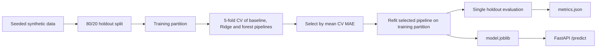

# House Price Lab

Reproducible classical ML experiments for housing price regression, with leakage-safe pipelines and a prediction API. This tabular regression lab focuses on reproducible splits, train-only preprocessing, candidate comparison, error analysis, and a local prediction endpoint. Synthetic results are kept separate from real-world housing data claims.

## Problem

The project demonstrates how to compare regression baselines without allowing learned preprocessing to leak across validation folds. The current data is generated from a known equation to exercise the workflow; it does not solve real-estate valuation.

## Features

- Deterministic synthetic data generator for pipeline verification.
- Mean baseline, Ridge and Random Forest compared with five-fold training-only CV.
- Imputation, scaling and one-hot encoding contained in estimator pipelines.
- Holdout metrics, residual summaries and model-specific feature magnitudes.
- Persisted pipeline served through a validated local FastAPI endpoint.

## Architecture



**Stack:** Python, pandas/NumPy, scikit-learn pipelines and metrics, joblib persistence, FastAPI/Pydantic, pytest and Ruff.

## Implementation details

For module-by-module walkthroughs, reproduction steps, and interview concepts, see [DEVELOPER_GUIDE.md](DEVELOPER_GUIDE.md).

`data.py` provides a deterministic synthetic generator used for code verification only. `train.py` reserves one 20% holdout test split, runs five-fold CV only on the remaining training split, compares a mean baseline, Ridge regression, and Random Forest, and selects the best candidate by CV MAE. Numeric and categorical imputation/encoding are fitted inside a scikit-learn pipeline, so CV folds do not share learned preprocessing. The selected model and a JSON report are written under `artifacts/`.

`api.py` validates feature ranges and allowed categories before applying the trained pipeline. It returns a 503 until the model artifact exists.

## Reproducible synthetic demonstration

```powershell
python -m venv .venv
.venv\Scripts\Activate.ps1
python -m pip install --upgrade pip
python -m pip install -e ".[dev]"
python -m house_price_lab.train --rows 1200 --seed 42 --output artifacts
python -m pytest -q
uvicorn house_price_lab.api:app --reload
```

Open `http://127.0.0.1:8000/docs`. A prediction request contains `area_sqft`, `bedrooms`, `age_years`, `location` (`central`, `suburban`, or `rural`), and `property_type` (`apartment`, `house`, or `townhouse`).

`artifacts/metrics.json` records the seed, split policy, CV MAE for all candidates, held-out MAE/RMSE/R², residual summaries, and model-specific feature magnitudes. Ridge magnitudes are absolute standardized coefficients; Random Forest magnitudes are impurity-based importance. Neither is a causal explanation.

## Dataset provenance and genuine results

The default data generator encodes a known synthetic price equation with added noise. Its scores verify the experiment code and are **not** genuine housing results.

A public candidate investigated was scikit-learn's California Housing dataset. Its official loader documentation describes 20,640 samples and points to StatLib as the source, but the documentation does not provide a clear data license grant. The dataset is therefore not bundled or used for a reported experiment in this repository. Before using it, confirm permission for your intended use with the source. [scikit-learn dataset documentation](https://scikit-learn.org/stable/modules/generated/sklearn.datasets.fetch_california_housing.html)

No real-data metrics are reported. Do not interpret this synthetic model as a property valuation tool.

### Verified synthetic run

Command: `python -m house_price_lab.train --rows 1200 --seed 42 --output artifacts`. The selected Ridge model had CV MAE **$22,646.60**; the mean baseline had CV MAE **$126,705.59**, and Random Forest had CV MAE **$26,162.80**. On the held-out synthetic test split, Ridge MAE was **$20,994.18**, RMSE **$26,430.58**, and R² **0.9686**. These values are reproducible workflow checks on generated data only.

## Tests

```powershell
python -m pytest -q
```

Tests check deterministic data generation, persisted model/report, repeated-seed consistency, API validation, health, prediction output, and the missing-model error. The training test uses a small synthetic sample and does not establish model quality.

CI on Python 3.11 runs Ruff lint and formatting checks, the test suite, and a pip-audit scan of runtime dependencies.

## Current limitations

The project does not yet include EDA plots, a licensed real housing dataset, a real-data experiment, hyperparameter search beyond the fixed Ridge/forest settings, or a permutation-importance analysis. The API loads a local joblib artifact; only load artifacts you created yourself. It is intended for local development, not public deployment.

## Roadmap

- Add a real dataset adapter only after confirming dataset terms and documenting provenance.
- Add a held-out permutation-importance report and residual plots.
- Add an API integration test using the trained pipeline artifact.

See [DEVELOPER_GUIDE.md](DEVELOPER_GUIDE.md) for a module walkthrough and interview concepts.

## License

MIT for this code. Dataset rights are separate; no housing data is redistributed here.
